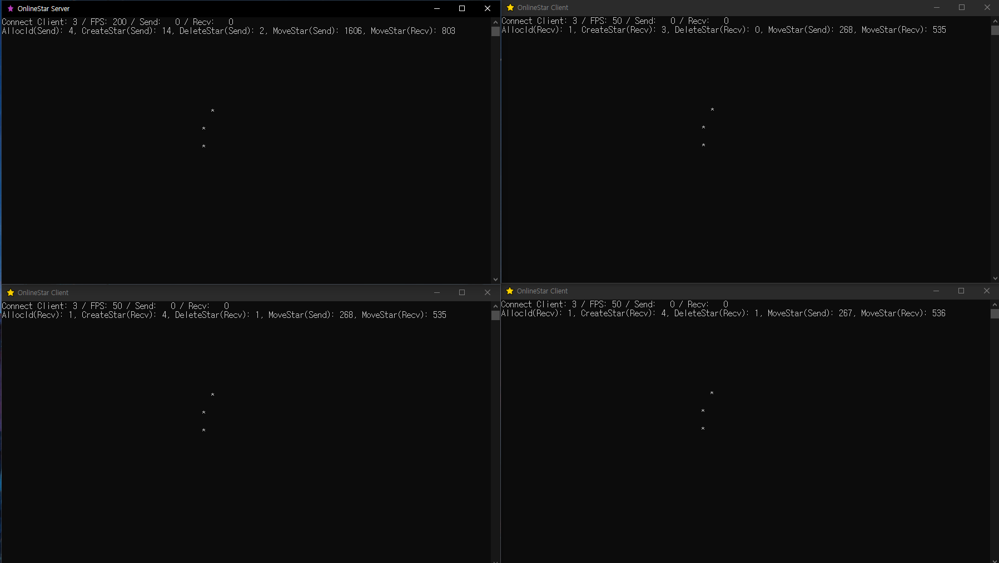
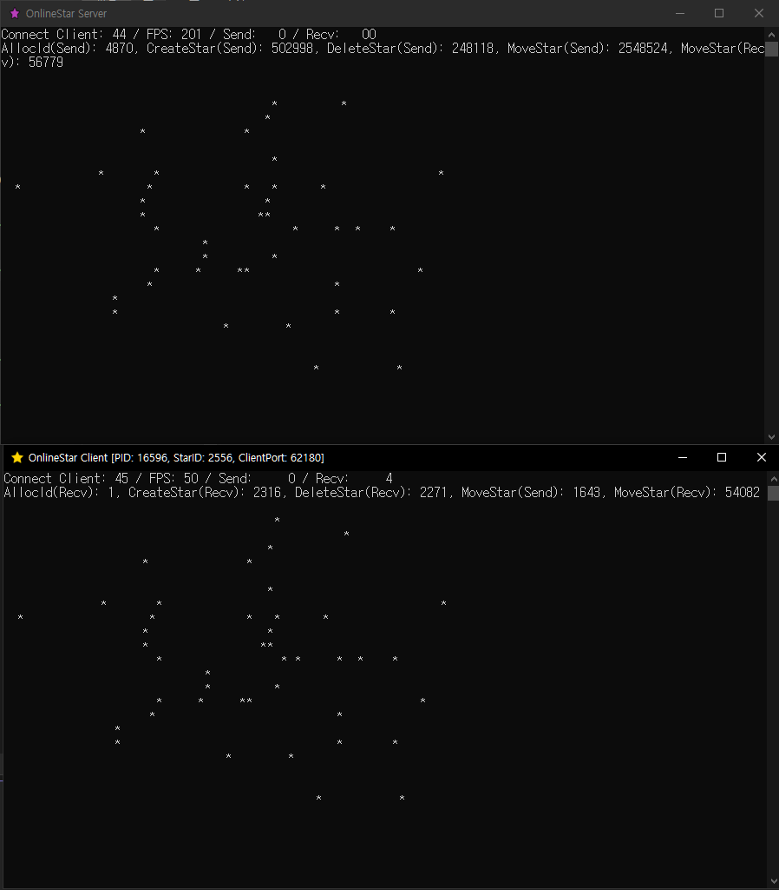
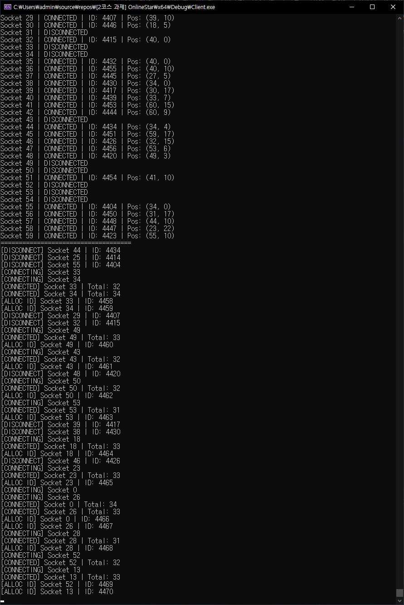

# 💥💥**과제중 발생한 문제 기록**💥💥 -> [문제해결](https://github.com/fkdla124/OnlineStar/tree/master/%EB%AC%B8%EC%A0%9C%ED%95%B4%EA%B2%B0)


# ⭐ OnlineStar
* socket API, tcp, Msg Protocol 에 대해 학습하기 위하여 진행하는 미니프로젝트. <br>
* 콘솔에서 멀티플레이로 별을 움직일 수 있음. <br>
* 직접만든 리스트 자료구조 사용(클라) -> [LinkedList](https://github.com/fkdla124/LinkedList) <br>
* STL list도 사용(서버)




# DummyTest 정상작동 (AI 활용)
* 서버 최대 연결제한인 60개 소켓으로 동시에 (연결 - 일정시간 랜덤 움직임 - 종료) 반복
* 각 소켓이 시간차를 달리하여 누군가는 움직일때 누군가는 종료하고 누군가는 연결중인 상황

 <br>

  
<br>

# 🖥️ Server
* 클라이언트 접속시 별 ID와 위치 정보를 전송해줌. 다른 별들의 정보도 전송해줌. <br>
* 클라이언트 접속 -> 별 아이디 지정 -> 모든 별 위치정보 전송 <br>
* 클라이언트들의 이동패킷 처리

<br>
<br>

# 🎮 Client
* 서버에 접속하여 다른 별들의 위치정보를 읽어오고 내 별을 움직일 수 있음. <br>
* 서버 접속 -> 나의 별 아이디 받아오기 -> 모든 별 위치정보 세팅 -> 내 별 움직이기 <br>

<br>
<br>

# 📐 학습을 위한 단순화 규칙
* 모든 메시지는 16바이트로 통일.
* 메시지는 잘려오지 않는다고 가정. 뭉쳐오는 것은 가능.
* L7 링버퍼를 만들지 않음. 이번 프레임에 보내지 못한 메시지는 고려하지 않음.
* select() 모델 학습을 위해 굳이 필요없음에도 일단 사용.
* 서버에서는 이동처리시 클라이언트에게 정확한 목적지를 받아서 모든 클라이언트가 같은자리에 서게끔 만들어야하지만,
   이부분을 고려하지않음.

<br>
<br>

# 🔍 디버깅 및 학습을 위한 소켓 에러코드 수집
* 이번 과제에서 10035, 10038, 10048, 10054, 10060, 10061 수집하였음.
* 에러코드 관련 수집 및 기록 리포지토리 링크 -> [📖 에러코드 기록](https://github.com/fkdla124/Socket_ErrorCode_Logging)
```cpp
//////////////////////////////////////////////////////////////////////////////////////////////////////////////
// SocketErrorCode Data //

// 아직 에러코드나 함수 리턴값을 받지 않은 상태를 구분하기 위해 내 생일을 넣어놓음
#define NOT_YET 0x20020315

// WSAStartup() -> 성공(0), 실패(!=0), 실패시 WSAGetLastError() 사용
int returnValueWSAStartup = NOT_YET;
int errorCodeWSAStartUp = NOT_YET;

// socket() -> 성공(소켓fd), 실패(INVALID_SOCKET), 실패시 WSAGetLastError() 사용
int errorCodeSocket = NOT_YET;

// bind() -> 성공(0), 실패(SOCKET_ERROR), 실패시 WSAGetLastError() 사용
int returnValueBind = NOT_YET;
int errorCodeBind = NOT_YET;

// listen() -> 성공(0), 실패(SOCKET_ERROR), 실패시 WSAGetLastError() 사용
int returnValueListen = NOT_YET;
int errorCodeListen = NOT_YET;

// accept() -> 성공(소켓fd), 실패(INVALID_SOCKET), 실패시 WSAGetLastError() 사용
int errorCodeAccept = NOT_YET;

// InetPton() -> 성공(1), 잘못된IP문자열형식(0), 실패(-1), 실패시 WSAGetLastError() 사용
int returnValueInetPton = NOT_YET;
int errorCodeInetPton = NOT_YET;

// connect() -> 성공(0), 실패(SOCKET_ERROR), 실패시 WSAGetLastError() 사용
// 논블로킹 SOCKET_ERROR -> WSAEWOULDBLOCK 체크
int returnValueConnect = NOT_YET;
int errorCodeConnect = NOT_YET;

// ioctlsocket() -> 성공(0), 실패(SOCKET_ERROR), 실패시 WSAGetLastError() 사용
int returnValueIoctlSocket = NOT_YET;
int errorCodeIoctlSocket = NOT_YET;

// setsockopt() -> 성공(0), 실패(SOCKET_ERROR), 실패시 WSAGetLastError() 사용
int returnValueSetSockOpt = NOT_YET;
int errorCodeSetSockOpt = NOT_YET;

// select() -> 성공(소켓개수), 실패(SOCKET_ERROR), 실패시 WSAGetLastError() 사용
int returnValueSelect = NOT_YET;
int errorCodeSelect = NOT_YET;

// recv() -> 성공(읽은 바이트수), 실패(SOCKET_ERROR), 종료(0), 실패시 WSAGetLastError() 사용
// 논블로킹 SOCKET_ERROR -> WSAEWOULDBLOCK 체크
int returnValueRecv = NOT_YET;
int errorCodeRecv = NOT_YET;

// send() -> 성공(송신버퍼에 복제한 바이트수), 실패(SOCKET_ERROR), 실패시 WSAGetLastError() 사용
// 논블로킹 SOCKET_ERROR -> WSAEWOULDBLOCK 체크
int returnValueSend = NOT_YET;
int errorCodeSend = NOT_YET;
//////////////////////////////////////////////////////////////////////////////////////////////////////////////
```

<br>
<br>

# 📦 Message Protocol
```cpp
//////////////////////////////////////////////////////////////////////////////////////////////////////////////
// Message Protocol //

#pragma pack(push, 1)
struct MsgAllocID
{
	int type;	// 0       메시지헤더, 데이터를 나눠야 하지만 지금은 그냥 붙여서 일괄로 보낸다.
	int id;
	int dummy1;	// 필요없으면 원래 안보내야하지만 학습용이니 메시지의 사이즈를 16바이트로 통일한다.
	int dummy2;
};

struct MsgCreateStar
{
	int type;	// 1
	int id;
	int col;	// x
	int row;	// y
};

struct MsgDeleteStar
{
	int type;	// 2
	int id;
	int dummy1;
	int dummy2;
};

struct MsgMoveStar
{
	int type;	// 3
	int id;		// 클라 -> 서버 내가 이동한다는 패킷에서는 id를 줄 필요가 없다. 서버는 나를 알고있다.
	int col;	// x
	int row;	// y
};
#pragma pack(pop)

enum class MsgType
{
	ALLOCID = 0,
	CREATESTAR = 1,
	DELETESTAR = 2,
	MOVESTAR = 3
};
//////////////////////////////////////////////////////////////////////////////////////////////////////////////
```
