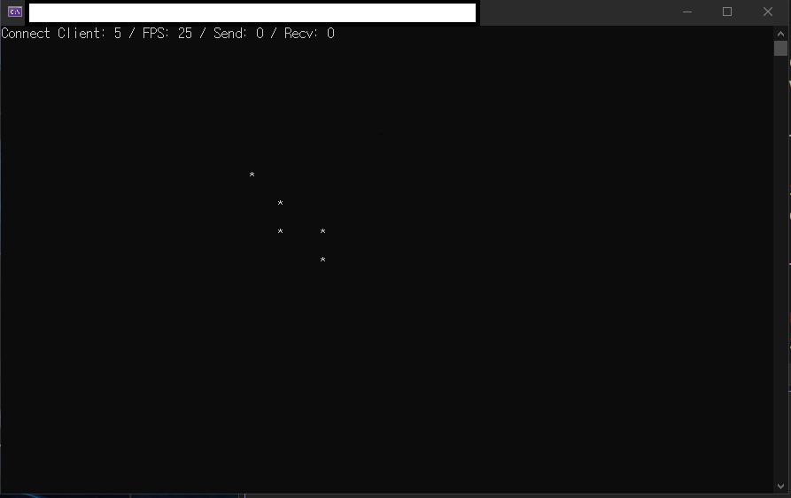

# ⭐ OnlineStar
socket API 함수들과 tcp 개념을 익히기 위하여 진행하는 미니프로젝트  
콘솔에서 멀티플레이로 별을 움직일 수 있음.  

# Server
클라이언트 접속시 별 ID와 위치 정보를 전송해줌. 다른 별들의 정보도 전송해줌.  

# Client
서버에 접속하여 다른 별들의 위치정보를 읽어오고 내 별을 움직일 수 있음.  
25 FPS로 제작.  
