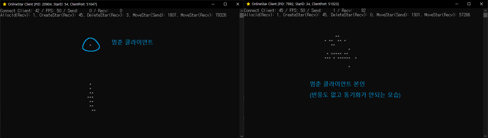
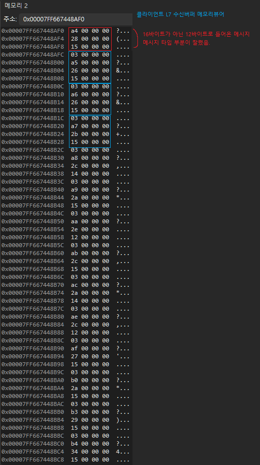
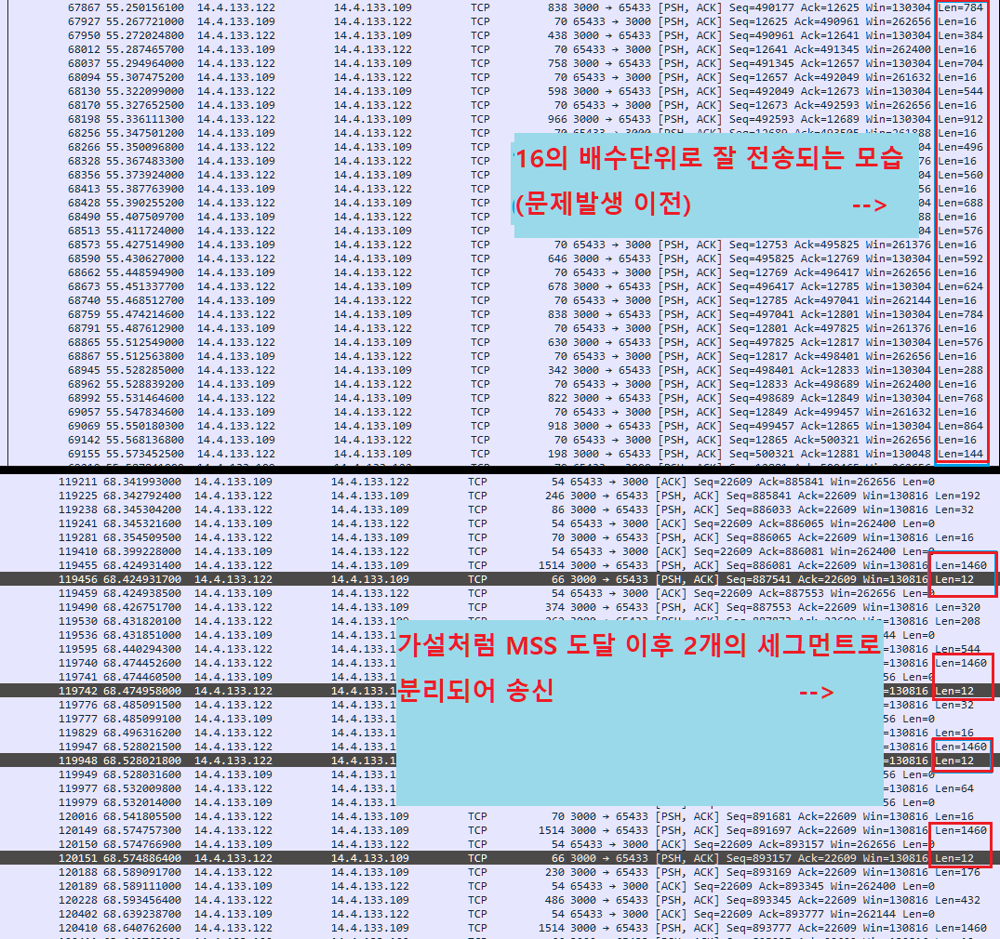
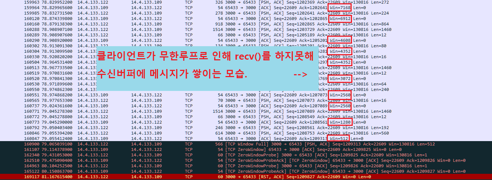

# 문제발생 환경

| 하드웨어 | 서버  | 클라이언트 |
|---|---|---|
| **CPU** | Intel Core i3-3217U @ 1.80GHz | AMD Ryzen 5 5600X 6-Core |
| **RAM** | 4GB | 32GB |
| **LAN 어댑터** | Intel Centrino Wireless-N 2230 (Wi-Fi) | Intel Ethernet Controller I225-V (유선) |
| **IP** | 공유기 고정 DHCP (192.168.219.200) | 통신사 직통 공인 IP |
| **Port** | TCP 3000 (포트 포워딩 및 방화벽 인바운드 설정) | OS 동적 포트 (16,384개 범위 중 랜덤 할당) |

## 🔧 문제 해결 과정

### 1. 문제 발생

- 클라이언트 40개 접속 후 약 30초간 동시 이동 테스트 진행.
- 특정 클라이언트가 갑자기 멈추고, 이후 연결까지 종료되는 현상 발생. <br>


### 2. 문제 추적

- Visual Studio 디버거 및 Wireshark 추적 환경 구성.
- 디버깅을 위해 클라이언트 콘솔 타이틀에 PID, Star ID, Local Port 표시.
```cpp
SOCKADDR_IN clientAddr = { 0, };
int clientAddrLen = sizeof(clientAddr);
returnValueGetSockName = getsockname(sock, (sockaddr*)&clientAddr, &clientAddrLen);
if (returnValueGetSockName == SOCKET_ERROR)
{
  errorCodeGetSockName = WSAGetLastError();
  printf("getsockname() error. %d\n", errorCodeGetSockName);
  Sleep(INFINITE);
}

wsprintf(title, L"OnlineStar Client [PID: %d, StarID: %d, ClientPort: %hu]", processId, myStar->id, ntohs(clientAddr.sin_port));
SetConsoleTitle(title);
```

**서버 로그**

| 항목 | 내용 |
|---|---|
| 함수 | `send()` |
| 오류 코드 | `10035 (WSAEWOULDBLOCK)` |
| 메시지 | `MoveStr` |
| 대상 | `Star ID 173` |

로그에 기록된 173번 클라이언트가 실제로 멈춰 있는 것을 확인하고, 해당 프로세스에 디버거를 연결했다.

프로세스를 일시 정지한 뒤 코드를 추적한 결과, **잘못된 메시지 타입을 해석하면서 무한루프에 빠지는 현상**을 발견했다.



### 3. 원인 분석

Wireshark 패킷 캡처 결과, 정상적인 16바이트 단위의 데이터 전송 중 12바이트만 전송되는 세그먼트를 확인했다.



Nagle 알고리즘으로 데이터가 누적되다가 MSS(1,460바이트)를 초과하면서 다음과 같이 분할 전송된 것으로 판단하였다.

- 첫 번째 세그먼트: 1,460바이트
- 두 번째 세그먼트: 12바이트

12바이트 메시지가 클라이언트에 수신되는 순간 메시지 파싱이 정상적으로 이루어지지 않아 무한루프에 빠진다.

클라이언트가 무한루프에 빠지면 recv()를 수행하지 않아 수신버퍼에 메시지가 쌓이게 된다.
수신버퍼가 꽉 차서 서버쪽에서 메시지를 보낼 수 없으면 서버쪽 send()에서 오류가나고 연결을 끊는다.



### 4. 해결 방법

잘못된 메시지 타입이 발견되면 해당 프레임에서 수신한 메시지를 모두 폐기하고 메시지 처리를 건너뛰도록 수정했다.

현재 클라이언트가 수신하는 메시지는 다른 별의 이동 정보뿐이므로, 일부 프레임의 이동 데이터가 누락되더라도 이후 수신되는 최신 이동 정보로 다시 동기화할 수 있다고 판단했다.

### 5. 테스트 결과

수정 후 다시 동시 이동 테스트를 진행했다.

- 기존 40개를 초과하는 **클라이언트 60개 동시 접속**
- 장시간 동시 이동 테스트에서 기존과 같은 클라이언트 멈춤 현상 없이 정상 동작 확인


