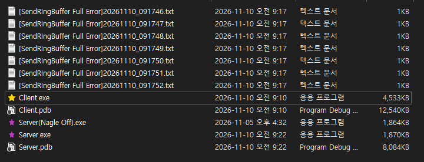
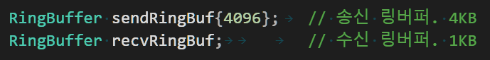

# 더미클라 테스트중 서버쪽 로그파일 생성
* 송신 링버퍼에 메시지 추가중 링버퍼 공간부족으로 로그파일 생성.


# 로그파일 내용
```text
RingBuffer Full error. FILE: C:\Users\admin\source\repos\[2코스 과제] OnlineStar\Server\server.cpp, LINE: 465, recvSessionID: 1902 
RingBuffer Capacity: 1024
RingBuffer Size: 1024
Push MsgLen: 16
returnValuePush: 0
MsgType = 3
```
* 링버퍼 기본 사이즈인 1KB가 부족하여 이동메시지를 전송하지 못한 모습.
* 60명정도의 인원에 대한 프레임당 메시지 송신량이 1KB면 충분할 것이라고 판단했지만 틀렸음

# 링버퍼 사이즈 수정으로 해결

* 이후 같은 에러 로그가 남지 않았음.
